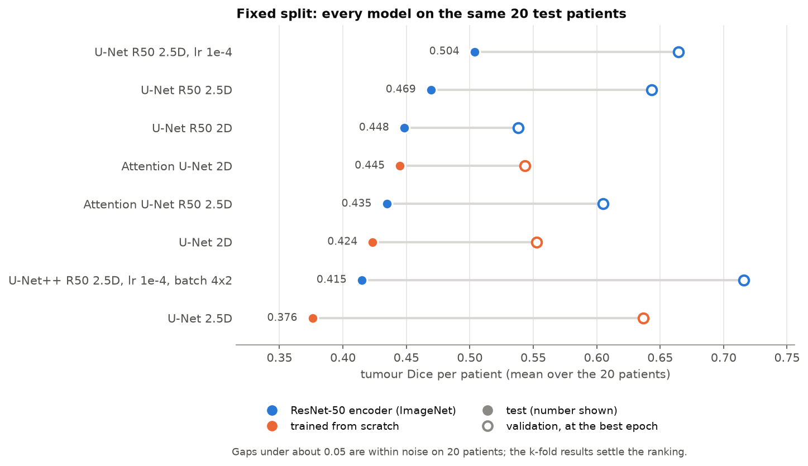
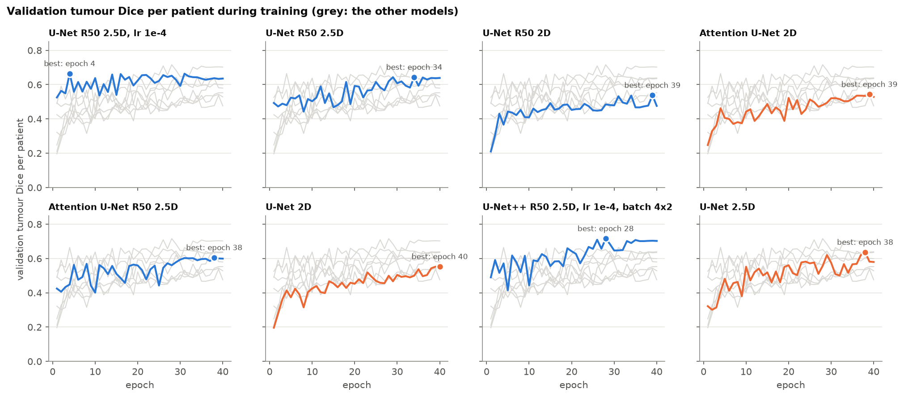
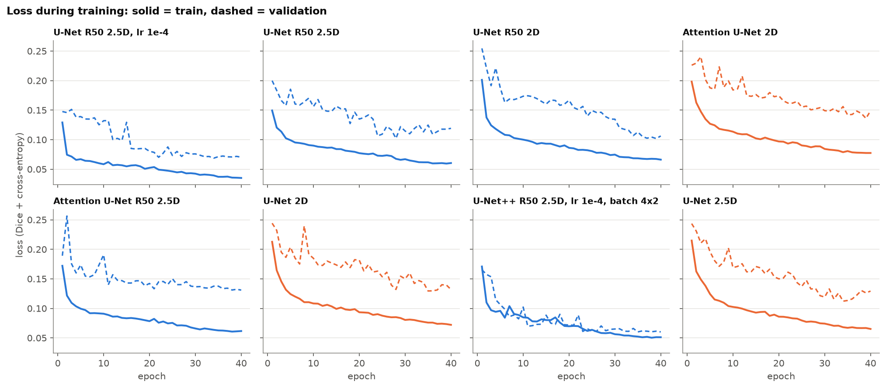
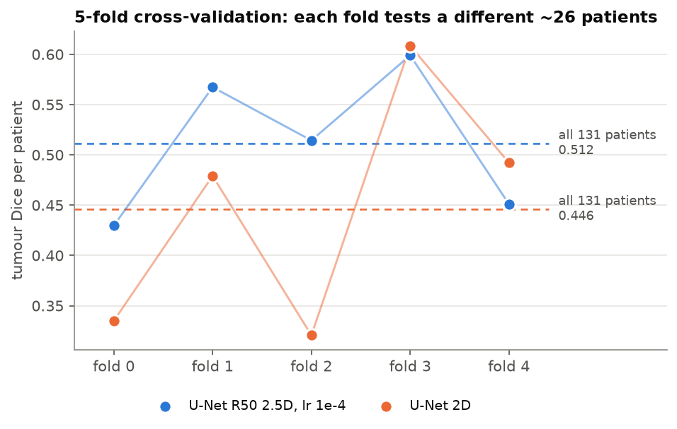
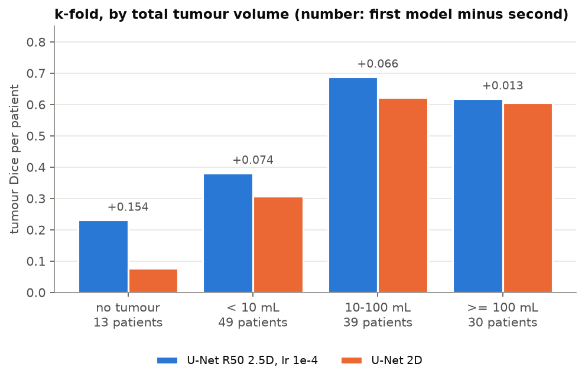
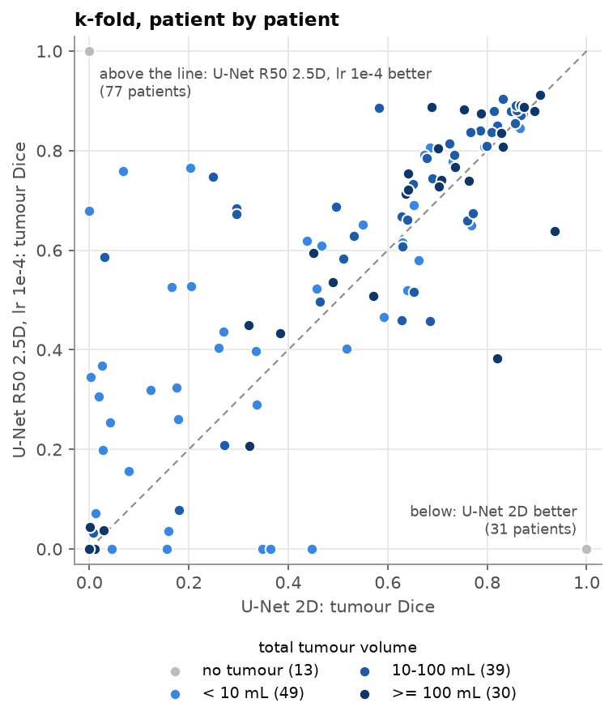
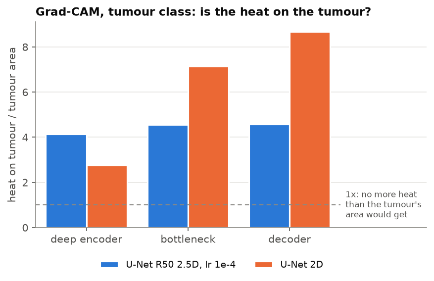

# Results: liver and tumour segmentation on MSD Task03_Liver (NIfTI, 512 x 512)

_Generated by `python -m src.utils.results` from the run folders in `runs/nifti/`. Do not edit by hand - run it again after a new run._

## At a glance

- **Best model: U-Net R50 2.5D, lr 1e-4** - tumour Dice per patient **0.512** (median 0.609) over all 131 patients, 5-fold cross-validation; liver 0.938.
- Against U-Net 2D (0.446): +0.065 ± 0.021 over the same patients, better on 77 of them and worse on 31.
- On the fixed 20-patient split the best was U-Net R50 2.5D, lr 1e-4 (0.504); every gap to it is under 2 std errors, so the split alone cannot rank the models.
- 22 training runs in total, 195 GPU hours on the RTX 2070.

**How to read the scores.** _Tumour/pt_ = tumour Dice of each patient, then the mean (LiTS rule: a patient with no tumour scores 1 if none is predicted, else 0). _Pooled_ = one Dice over all test pixels together, so big tumours dominate it. _Precision / recall_ are pooled. Every score is after the 3D clean-up (largest liver piece kept). Only slices that contain liver are evaluated.

## 1. Fixed split: every model on the same 20 test patients

70 / 15 / 15 % of the 131 patients for train / validation / test, split by patient. The best epoch is the one with the highest validation tumour Dice per patient. _vs best_ is the paired difference to the best model on the same patients, ± its std error.

| Model | Encoder | Params | Hours | Best epoch | Val tumour/pt | **Test tumour/pt** | Median | Pooled | Precision | Recall | Liver/pt | vs best (paired) |
| :--- | :--- | ---: | ---: | ---: | ---: | ---: | ---: | ---: | ---: | ---: | ---: | ---: |
| U-Net R50 2.5D, lr 1e-4 | ResNet-50 (ImageNet) | 32.5 M | 8.1 | 4 | 0.664 | **0.504** | 0.580 | 0.753 | 0.893 | 0.651 | 0.947 | best |
| U-Net R50 2.5D | ResNet-50 (ImageNet) | 32.5 M | 6.3 | 34 | 0.643 | 0.469 | 0.557 | 0.759 | 0.863 | 0.677 | 0.948 | -0.034 ± 0.061 |
| U-Net R50 2D | ResNet-50 (ImageNet) | 32.5 M | 6.2 | 39 | 0.538 | 0.448 | 0.479 | 0.763 | 0.848 | 0.693 | 0.933 | -0.055 ± 0.059 |
| Attention U-Net 2D | scratch | 7.9 M | 7.4 | 39 | 0.543 | 0.445 | 0.529 | 0.762 | 0.813 | 0.717 | 0.930 | -0.059 ± 0.072 |
| Attention U-Net R50 2.5D | ResNet-50 (ImageNet) | 34.4 M | 7.1 | 38 | 0.605 | 0.435 | 0.535 | 0.728 | 0.824 | 0.652 | 0.939 | -0.069 ± 0.076 |
| U-Net 2D | scratch | 7.8 M | 6.2 | 40 | 0.553 | 0.424 | 0.436 | 0.762 | 0.821 | 0.711 | 0.933 | -0.080 ± 0.063 |
| U-Net++ R50 2.5D, lr 1e-4, batch 4x2 | ResNet-50 (ImageNet) | 49.0 M | 21.9 | 28 | 0.716 | 0.415 | 0.417 | 0.754 | 0.840 | 0.685 | 0.943 | -0.089 ± 0.065 |
| U-Net 2.5D | scratch | 7.8 M | 6.4 | 38 | 0.637 | 0.376 | 0.326 | 0.745 | 0.802 | 0.696 | 0.920 | -0.128 ± 0.071 |

Training curves and loss of each model

**Runs left out of the table** (still in `summary/runs.csv`):

| Model | Run | Test tumour/pt | Pooled | Why it is not in the main table |
| :--- | :--- | ---: | ---: | :--- |
| Attention U-Net 2D, old epoch rule | `baseline/attention_unet_2d_old-epoch-rule` | - | 0.715 | best epoch picked by foreground Dice; retrained with the tumour rule |
| U-Net 2D, old epoch rule | `baseline/unet_2d_old-epoch-rule` | - | 0.687 | best epoch picked by foreground Dice; retrained with the tumour rule |
| U-Net++ R50 2.5D, batch 4 | `r50/unetpp_r50_2.5d_batch4` | 0.333 | 0.706 | lr 1e-3 too high: tumour Dice collapsed to 0 in several epochs |
| U-Net++ R50 2.5D, batch 4x2 | `r50/unetpp_r50_2.5d_batch4x2` | 0.343 | 0.704 | lr 1e-3 with batch 4x2: still collapsed; lr 1e-4 fixed it |

## 2. 5-fold cross-validation: every patient tested once

The 131 patients are shuffled once and cut into 5 folds. Each run tests one fold, validates on 20 patients from the other four and trains on the rest (~85). Each patient is so tested exactly once, by a model that never saw it.

| Model | Folds | Patients | **Tumour/pt** | Median | Liver/pt | Folds: mean ± std | Worst - best fold | GPU hours |
| :--- | ---: | ---: | ---: | ---: | ---: | ---: | ---: | ---: |
| U-Net R50 2.5D, lr 1e-4 | 5 | 131 | **0.512** | 0.609 | 0.938 | 0.512 ± 0.065 | 0.430 - 0.599 | 36 |
| U-Net 2D | 5 | 131 | **0.446** | 0.511 | 0.920 | 0.447 ± 0.107 | 0.321 - 0.608 | 32 |

**Patient by patient.** The same patients, each tested once by the fold that held it out, scored by both models:

- U-Net R50 2.5D, lr 1e-4 minus U-Net 2D: **+0.065 ± 0.021** (std error, 131 patients) - a real difference. Better on 77 patients, worse on 31, the same on 23.

**Per fold:**

| Fold | Patients | U-Net R50 2.5D, lr 1e-4 | U-Net 2D | difference (first - U-Net 2D) |
| :--- | ---: | ---: | ---: | ---: |
| 0 | 27 | 0.430 | 0.335 | +0.095 ± 0.046 |
| 1 | 26 | 0.567 | 0.479 | +0.088 ± 0.044 |
| 2 | 26 | 0.514 | 0.321 | +0.194 ± 0.052 |
| 3 | 26 | 0.599 | 0.608 | -0.009 ± 0.026 |
| 4 | 26 | 0.451 | 0.492 | -0.041 ± 0.053 |

**By total tumour volume** (tumour Dice per patient; in brackets, patients scored 0):

| Tumour volume | Patients | U-Net R50 2.5D, lr 1e-4 | U-Net 2D | difference (first - U-Net 2D) |
| :--- | ---: | ---: | ---: | ---: |
| no tumour | 13 | 0.231 (10) | 0.077 (12) | +0.154 ± 0.154 |
| < 10 mL | 49 | 0.381 (12) | 0.307 (7) | +0.074 ± 0.032 |
| 10-100 mL | 39 | 0.688 (0) | 0.622 (0) | +0.066 ± 0.026 |
| >= 100 mL | 30 | 0.618 (1) | 0.606 (1) | +0.013 ± 0.023 |

## 3. Grad-CAM: does the model look at the tumour?

Seg-Grad-CAM for the tumour class on each test patient's slice with the most tumour, at three depths of the network. The share of the heat that falls on the true tumour is compared with the share of the slice the tumour covers: 4x means four times more heat than its area alone would give.

| Model | Slices | Tumour area | Heat on tumour: deep encoder | bottleneck | decoder | Liver: area -> heat per layer | Tumour missed |
| :--- | ---: | ---: | ---: | ---: | ---: | ---: | ---: |
| U-Net R50 2.5D, lr 1e-4 | 118 | 1.2% | 4.8% (4.1x) | 5.3% (4.5x) | 5.4% (4.6x) | 11% -> 13% / 17% / 15% | 14 of 118 |
| U-Net 2D | 118 | 1.2% | 3.2% (2.8x) | 8.4% (7.1x) | 10.2% (8.7x) | 11% -> 11% / 17% / 16% | 17 of 118 |

_Note: U-Net 2D, bottleneck: 21 of 118 maps came out empty (the weighted sum was negative everywhere, so the ReLU left nothing) and are left out of its mean._

Heat maps for single patients: `gradcam/<run>.png`.

## Folders

| Folder | What is in it |
| :--- | :--- |
| `summary/` | this overview's tables (csv) and figures - `python -m src.utils.results` |
| `comparisons/` | one experiment at a time: training curves and test scores of its runs - `python -m src.utils.compare --group nifti/<group>` |
| `kfold/` | k-fold summaries as text - `python -m src.utils.kfold --group nifti/kfold` |
| `gradcam/` | Grad-CAM heat maps and tables, one per run - `python -m src.utils.gradcam --run <run>` |
| `dataset/` | the MSD Task03_Liver dataset: sizes, spacing, HU, tumour volumes - `python -m src.utils.nifti_report` |
| `viewer/` | screenshots and exports of the 3D viewer - `python -m src.utils.viewer`, `view3d` |
| `cases/` | single patients looked at closely (e.g. the dark tumour of patient 104) |
| `baseline/` | the first NIfTI baseline (Oct 2026) and the internship models run on the NIfTI data - superseded, kept for the record |

## Models

The drawings are in `architecture/nifti/` (the internship's 256 px ones in `architecture/internship_png/`). The from-scratch models are drawn with one slice in (2D), the ResNet-50 ones with three (2.5D); the parameter count is for that input (the first convolution grows by a few hundred weights per extra slice).

| Model | Encoder | Trained on NIfTI with | Parameters (as drawn) | Drawing |
| :--- | :--- | :--- | ---: | :--- |
| U-Net | from scratch | 2D, 2.5D | 7,762,531 | [unet.png](../../architecture/nifti/unet.png) |
| Attention U-Net | from scratch | 2D | 7,894,783 | [attention_unet.png](../../architecture/nifti/attention_unet.png) |
| U-Net R50 | ResNet-50, ImageNet | 2D, 2.5D | 32,521,011 | [unet_r50.png](../../architecture/nifti/unet_r50.png) |
| Attention U-Net R50 | ResNet-50, ImageNet | 2.5D | 34,350,239 | [attention_unet_r50.png](../../architecture/nifti/attention_unet_r50.png) |
| U-Net++ R50 | ResNet-50, ImageNet | 2.5D | 48,985,651 | [unetpp_r50.png](../../architecture/nifti/unetpp_r50.png) |
